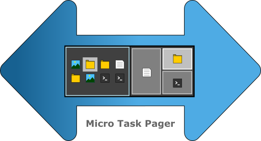

# Micro Task Pager

  

## Description

*Micro Task Pager* is a desktop pager for Windows, inpsired by various Linux desktop environments.
...

## Features
...

## Acknowledgements

- [Switchie](https://github.com/darkguy2008/Switchie) (the abandoned original project that *Micro Task Pager* is based on)
- [VirtualDesktop](https://github.com/MScholtes/VirtualDesktop) (thanks to this great project we have desktop management also in recent versions of Windows 10/11)

Made with ♥ from Munich, Germany
