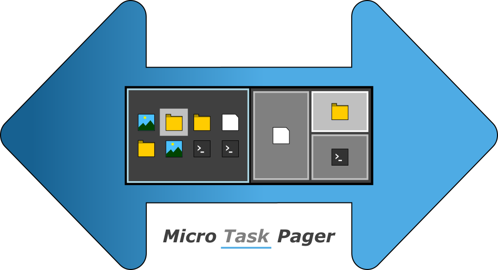
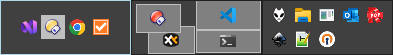

# Micro Task Pager

<p align="center">
  
</p>

<p align="center">
  A compact, always-available desktop pager for Windows 10 and 11.
</p>

<p align="center">
  <a href="https://github.com/Robbson/micro-task-pager/releases/latest"></a>
  <a href="LICENSE"></a>
  
</p>

**Micro Task Pager** gives you a permanent overview of your Windows virtual desktops. It shows what is open on every desktop, lets you switch with a single click, and lets you move windows between desktops with drag and drop.

Unlike a simple desktop switcher, it can display each desktop in one of two ways:

- **Preview** — a miniature of the real screen, including window positions and z-order.
- **Micro Taskbar** — a compact strip of application icons, ideal for small screens and maximized windows.

Each desktop screen can use its own view, so you can mix both styles however you like.

<p align="center">
  
  <br>
  <em>Micro Task Pager with several desktops, using both preview and Micro Taskbar views.</em>
</p>

## Why another pager?

Windows virtual desktops are useful, but the native experience has limitations: there are only a few fixed shortcuts, there is no persistent overview of all desktops, and the Task View (`Win` + `Tab`) is a full-screen interruption rather than a quick glance.

Micro Task Pager fills that gap with a small panel that stays out of the way and is always ready when you need it. It uses the native virtual desktop features of Windows, so it works alongside other window managers and desktop tools instead of replacing them.

> [!NOTE]
> Windows has no native support for oversized desktops, so the pager does not implement virtual desktop *pages* as some classic Linux tools do.

## Features

- Switch to any virtual desktop with a single mouse click.
- See all desktops at once, with a near real-time view of their windows.
- Choose **Preview** or **Micro Taskbar** rendering independently for each desktop screen.
- Drag and drop windows between virtual desktops.
- Click a window in the current desktop to bring it to the front.
- Return to the last active window automatically when switching back to a desktop.
- Reposition the pager by dragging it, and save, restore, or reset its position from the context menu.
- Keep the pager visible on every virtual desktop and above other windows; it restores itself when covered.
- Use multiple monitors; screen changes are detected while the app is running. High-DPI displays are supported through DPI-aware rendering.
- Customize pager height, icon padding, colors, border style, opacity, and update intervals.
- Automatically follows the number of virtual desktops, including desktops added or removed at runtime.
- Prevents multiple instances from running at the same time.
- Runs without administrator rights and stores its settings per user.
- Writes diagnostic logs to `%LOCALAPPDATA%\MicroTaskPager\logs`.
- Free and open source, with no Windows patches or shell extensions required.

## Getting started

### Requirements

- Windows 10 or Windows 11, 64-bit. Current Windows 11 releases, including 26H2, are tested.
- .NET Framework 4.8 or newer. It is included in Windows 10 version 1903 and later, as well as Windows 11.
- On ARM64 devices running Windows 11, the x64 build runs through Windows emulation; there is no native ARM64 build yet.

### Installation

1. Download the latest `MicroTaskPager-v*.zip` from the [releases page](https://github.com/Robbson/micro-task-pager/releases/latest).
2. Extract the archive.
3. Run `MicroTaskPager.exe`.

No installer is required. Keep the extracted files together: the executable needs the bundled DLLs and `MicroTaskPager.exe.config`. The archive also contains this README, the changelog, the license, and the third-party notices.

> [!IMPORTANT]
> The application is not code-signed yet. Windows SmartScreen may therefore show a warning the first time you start it.

On first launch, the pager appears at the bottom center of the primary screen's working area, so it does not overlap the taskbar.

## Using the pager

| Action | How |
| --- | --- |
| Switch to a desktop | Left-click anywhere on that desktop's area. |
| Bring a window to the front | Left-click its miniature or icon while its desktop is active. |
| Move a window to another desktop | Drag its miniature or icon onto the target desktop. |
| Change a desktop's view | Right-click with the pointer over that desktop and choose **Toggle View Mode**. |
| Move the pager | Drag it with the middle mouse button, or hold `Shift` and drag with the left mouse button. |
| Open the menu | Right-click the pager. |
| Save or restore the pager position | Right-click, open **Position**, then choose **Save**, **Restore**, or **Default**. |
| Open settings | Right-click the pager and choose **Settings**. |
| Exit | Right-click the pager and choose **Exit**. |

### Preview view

The **Preview** view draws a scaled representation of each desktop, including the position, size, and stacking order of its windows. This is the closest equivalent to a traditional Linux-style pager and is useful when you want to understand the layout of a desktop at a glance.

### Micro Taskbar view

The **Micro Taskbar** view replaces the miniature layout with a compact strip of application icons, adding a second row when space is tight. It is especially useful on laptops and small displays where windows are usually maximized and stacked on top of each other. Icons are easier to recognize than overlapping preview rectangles, and the view remains readable even when the pager is only as tall as the Windows taskbar.

Each desktop's screen remembers its own view mode. Use **Toggle View Mode** on the desktop under the cursor to switch it.

## Configuration

Open **Settings** from the right-click menu. Changes are previewed live where possible and can be reverted per option or reset per tab.

- **Layout** — default view mode for new desktops, pager height, and icon padding.
- **Theme** — background opacity, desktop border style and colors, preview window colors, and active window highlighting.
- **Misc** — refresh intervals for window tracking and background tasks, plus whether the app appears in the Windows taskbar.

Settings and the saved pager position are stored under `HKEY_CURRENT_USER\SOFTWARE\MicroTaskPager`.

> [!NOTE]
> Automatic pinning of the pager to all virtual desktops requires **Show App In Taskbar** to be enabled. If you disable it, Windows limits what the app can do automatically, and you may need to pin it manually through Task View (`Win` + `Tab`).

## Known issues

- Not every visual parameter is configurable yet.
- Newly opened windows are occasionally not detected immediately.
- In **Micro Taskbar** view, the order of icons follows the window order and cannot be rearranged manually.
- The application is not code-signed, so SmartScreen warnings are expected.
- The project still targets .NET Framework 4.8, so there is no optimized native ARM64 build.

## Building from source

### Prerequisites

- Visual Studio 2022 with the **.NET desktop development** workload, or the .NET SDK with the .NET Framework 4.8 targeting pack.
- Windows 10 or Windows 11.

### Build

```powershell
git clone https://github.com/Robbson/micro-task-pager.git
cd micro-task-pager
dotnet build src/MicroTaskPager.csproj
```

Alternatively, open `MicroTaskPager.sln` in Visual Studio and build the solution.

### Create a release package

```powershell
cd src
.\Publish.cmd
```

The script publishes a release build to `prod\` and creates a versioned ZIP archive there. Note that the build automatically increments the version in `src\version.txt`.

## Feedback

Bug reports and feature requests are welcome in the [issue tracker](https://github.com/Robbson/micro-task-pager/issues).

## Acknowledgements

- [Switchie](https://github.com/darkguy2008/Switchie) — the original project this app is based on.
- [VirtualDesktop](https://github.com/MScholtes/VirtualDesktop) — virtual desktop management for recent Windows 10 and 11 versions.

## License

Released under the [MIT License](LICENSE).

Made with ♥ in Munich, Germany.
