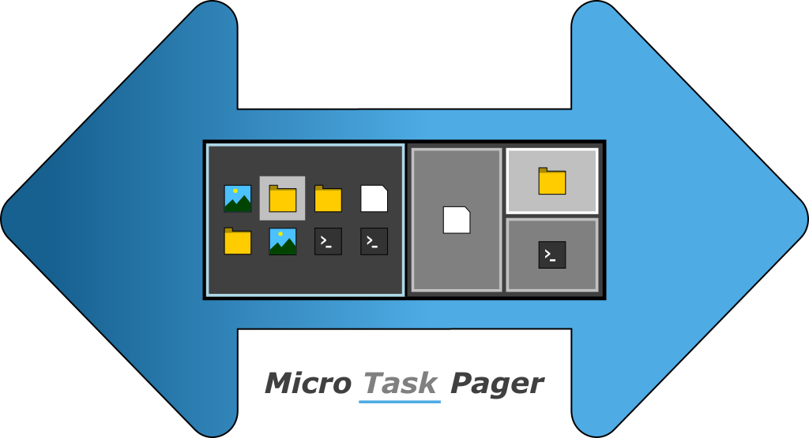
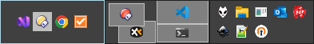

  

  A compact, always-available desktop pager for Windows 10 and 11.

  
  
  

**Micro Task Pager** gives you a permanent overview of your virtual desktops in _Windows_. It shows what is open on every desktop, lets you switch with a single click, and lets you move windows between desktops with drag and drop.

Unlike a simple desktop switcher, it can display each desktop in one of three ways:

- **Preview** — a miniature of the real screen, including window positions and z-order.
- **Micro Taskbar** — a compact strip of application icons, ideal for small screens and maximized windows.
- **Micro Taskbar Light** - same as above but without showing minimized windows. 

Each desktop screen can use its own view, so you can mix both styles however you like.

  
   
  <em>Micro Task Pager with several desktops, using both preview and Micro Taskbar views.</em>

## Why another pager?

Windows virtual desktops are useful, but the native experience has limitations: there are only a few fixed shortcuts, there is no persistent overview of all desktops, and the Task View (`Win` + `Tab`) is a full-screen interruption rather than a quick glance.

Micro Task Pager fills that gap with a small panel that stays out of the way and is always ready when you need it. It uses the native virtual desktop features of Windows, so it works alongside other window managers and desktop tools instead of replacing them.

> Note: Windows has no native support for oversized desktops, so the pager does not  
> implement virtual desktop _pages_ as some classic Linux tools do.

## Features

- Switch to any virtual desktop with a single mouse click.
- Move the pager anywhere you want, it always stays in front.
- Save your favorite pager position.
- See all desktops at once, with a real-time* view of their windows.
- Choose a view mode for each desktop independently: **Preview**,  **Micro Taskbar** or **Micro Taskbar Light**.
- Drag and drop windows between desktops.
- Use multiple monitors including High-DPI displays.
- Customize nearly everything like icon sizes, coloring and application behaviour.
- Runs without administrator rights and stores its settings per user.
- Free and open source, with no Windows patches or shell extensions required.
- Implemented in C#/.NET as well as in Rust: Choose the implementation which fits your needs best.

*_the app intentionally uses a lower update frequency to limit CPU usage but a faster  
or real-time update can be enforced by the user in the settings_ 

## Getting started

### Requirements

- Windows 10 or Windows 11, 64-bit. Current Windows 11 releases, including 26H2, are tested.
- .NET Framework 4.8 or newer. It is included in Windows 10 version 1903 and later, as well as Windows 11.
- On ARM64 devices running Windows 11, the x64 build runs through Windows emulation; there is no native ARM64 build yet.

### Installation

1. Download the tool from the [release page](https://github.com/Robbson/micro-task-pager/releases/latest), or [build it from source](build).
2. Extract the archive.
3. Run `MicroTaskPager.exe`.

No installer is required. Keep the extracted files together: the executable needs the bundled DLLs and `MicroTaskPager.exe.config`.
But keep in mind, that the app is not code-signed yet. Windows SmartScreen may therefore show a warning the first time you start it.

On first launch, the pager appears at the bottom center of the primary screen's working area, so it does not overlap the taskbar.

> Read more about [how to use the pager](usage).

## Known issues

- Not every visual parameter is configurable yet.
- Newly opened windows are occasionally not detected immediately.
- In **Micro Taskbar (Light)** views, the order of icons follows the window order and cannot be rearranged manually.
- The application is not code-signed, so SmartScreen warnings are expected.
- The C# implementation intenionally targets the old .NET Framework 4.8, so there is no optimized native ARM64 build.

## Feedback

Bug reports and feature requests are welcome in the [issue tracker](https://github.com/Robbson/micro-task-pager/issues).

## Acknowledgements

- [Switchie](https://github.com/darkguy2008/Switchie) — the original project this app is based on.
- [VirtualDesktop](https://github.com/MScholtes/VirtualDesktop) — virtual desktop management for recent Windows 10 and 11 versions.

## License

Released under the [MIT License](license).

Made with ♥ in Munich, Germany.
