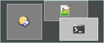
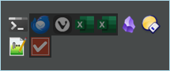
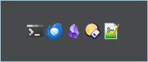
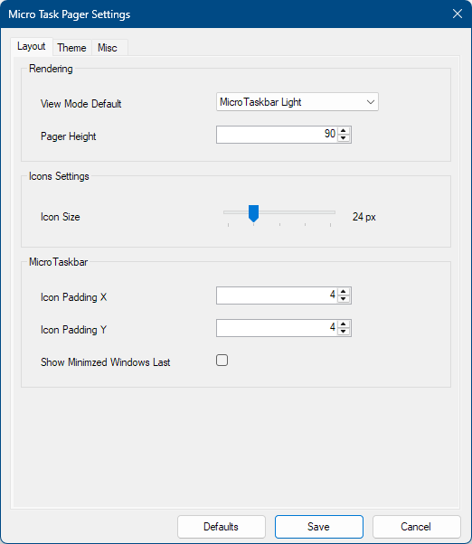
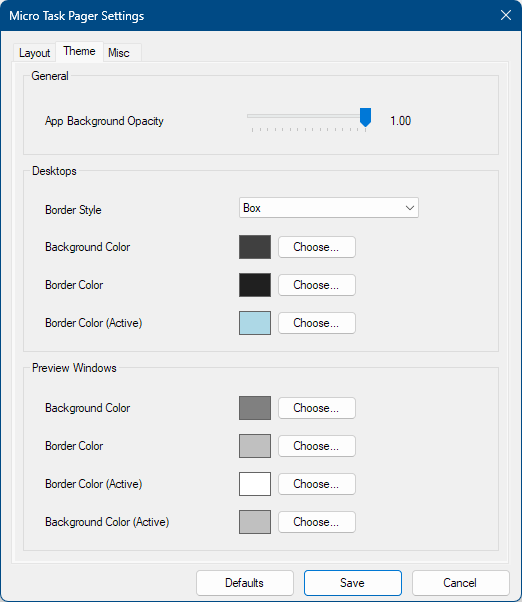
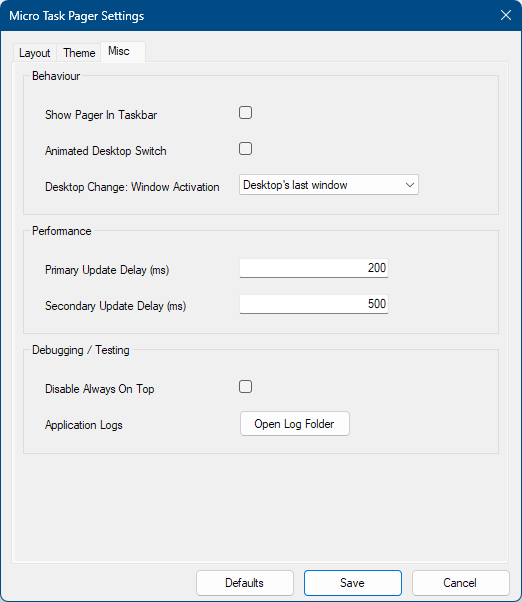

# Using the pager

| Action | How |
| -------------------------------| -------------------------------------------------------------------------------------------------------- |
| Switch to a desktop                | Left-click anywhere on that desktop's area.                                        |
| Bring a window to the front        | Left-click its miniature or icon while its desktop is active.                      |
| Minimize a window (only in _Micro Taskbar_ View)        | Hold `Shift` + Left-click its icon while its desktop is active. |
| Move a window to another desktop   | Drag its miniature or icon onto the target desktop.                                                                                |
| Change a desktop's view            | Right-click with the pointer over that desktop and choose **Toggle View Mode**. Alternatively hold `Shift` and use the mouse wheel |
| Move the pager                     | Drag it with the middle mouse button, or hold `Ctrl` and drag with the left mouse button.                                          |
| Show window names                  | Hold `Ctrl` and hover with the mouse over the icons 
| Open the menu                      | Right-click the pager.                                                                                                             |
| Save or restore the pager position | Right-click, open **Position**, then choose **Save**, **Restore**, or **Default**.                                                 |
| Open settings                      | Right-click the pager and choose **Settings**.                                                                                     |
| Exit                               | Right-click the pager and choose **Exit**.                                                                                         |

## Preview view

The **Preview** view draws a scaled representation of each desktop, including the position, size, and stacking order of its windows. This is the closest equivalent to a traditional Linux-style pager and is useful when you want to understand the layout of a desktop at a glance.

## Micro Taskbar view

The **Micro Taskbar** view replaces the miniature layout with a compact strip of application icons, adding a second row when space is tight. It is especially useful on laptops and small displays where windows are usually maximized and stacked on top of each other. Icons are easier to recognize than overlapping preview rectangles, and the view remains readable even when the pager is only as tall as the Windows taskbar. Use `Shift` + Left-Click to minimize a window. 

## Micro Taskbar Light view

Same as **Micro Taskbar** but without minimized windows.

Each desktop's screen remembers its own view mode. Use **Toggle View Mode** on the desktop under the cursor to switch it.

# Configuration

Open **Settings** from the right-click menu. Changes are previewed live where possible and can be reverted per option or reset per tab.

- **Layout** 
  - Set the default view mode for new desktops.
  - Adjust the pager height.
  - Micro Taskbar: Set icon size and their horizontal/vertical padding.
  - Micro Taskbar: (optional) Show minimized windows last.
  

  

 
  
- **Theme** 
  - Set the background opacity of the application
  - Change the desktop's border style as well as its color, preview window colors and active window highlighting.

  

  

- **Misc**
  - Change desktop switch behavior (last window activation and the optional Windows 11 animation).
  - Determine if the app should appear in the Windows taskbar.
  - Set refresh intervals for window tracking and background tasks.
  - Disable the pager's always on top behavior.
  - Open the application logs when something went wrong.

  

  

> Note: Settings and the saved pager position are stored under `HKEY_CURRENT_USER\SOFTWARE\MicroTaskPager`.
